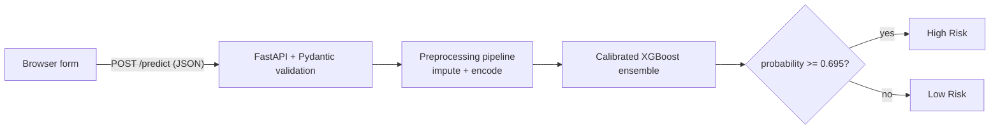

# Credit Ledger: Loan Default Risk Predictor

[](https://credit-ledger-mh8b.onrender.com)


An end-to-end machine learning project that estimates the probability a loan applicant will default. It covers data cleaning, leakage-safe preprocessing, model comparison, hyperparameter tuning, probability calibration, threshold selection, and deployment as a REST API with a web frontend.

**Live demo:** https://credit-ledger-mh8b.onrender.com

> The demo runs on Render's free plan, which sleeps after about 15 minutes of inactivity. The first request after a pause can take 30 to 60 seconds to wake the service.


## Table of contents

- [Overview](#overview)
- [How it works](#how-it-works)
- [Model and methodology](#model-and-methodology)
- [Results](#results)
- [API reference](#api-reference)
- [Project structure](#project-structure)
- [Run locally](#run-locally)
- [Deploy to Render](#deploy-to-render)
- [Limitations](#limitations)
- [Future work](#future-work)
- [Author](#author)

---

## Overview

Lenders must decide whom to approve and at what price. This project predicts the probability that an applicant defaults on a loan, then converts that probability into a **High Risk** or **Low Risk** decision using a tuned threshold.

- **Task:** binary classification (`loan_status`: 1 = default, 0 = repaid)
- **Data:** 32,581 loans, 11 input features, 21.8% defaulters
- **Model:** calibrated XGBoost pipeline, compared against a logistic regression baseline
- **Serving:** FastAPI with Pydantic input validation, plus a static HTML frontend

## How it works



The model and decision threshold are loaded once at startup. Each request is validated, converted to a one-row DataFrame, scored, and returned as JSON in milliseconds.

## Model and methodology

| Stage | What was done |
|---|---|
| Cleaning | Removed duplicates, ages outside 18-100, impossible employment lengths (above 60 years or longer than the applicant's age) and non-positive loan amounts. 32,581 rows became 31,522. |
| Split | 80/20 stratified train/test split (`random_state=42`): 25,217 train rows and 6,305 test rows |
| Preprocessing | Median imputation for numeric features; constant "Missing" fill and one-hot encoding for categorical features. Everything sits inside a scikit-learn `Pipeline`, so nothing is fitted on test data. |
| Class imbalance | Cost-sensitive weighting: `scale_pos_weight` of about 3.63 for XGBoost, `class_weight="balanced"` for logistic regression |
| Model comparison | 5-fold stratified CV. Logistic regression reached ROC-AUC 0.871; XGBoost reached 0.939. |
| Tuning | `RandomizedSearchCV`: 150 candidates x 5 folds, scored on average precision |
| Calibration | Platt scaling (`CalibratedClassifierCV`, sigmoid, 5-fold), because class weighting distorts raw probabilities |
| Threshold | 0.695, the value that maximizes F1 for the calibrated model |
| Explainability | SHAP analysis in the notebook |

**Inputs (11 features)**

| Feature | Type | Description |
|---|---|---|
| `person_age` | int | Applicant age in years |
| `person_income` | float | Annual income |
| `person_home_ownership` | str | `RENT`, `OWN`, `MORTGAGE`, `OTHER` |
| `person_emp_length` | float | Employment length in years |
| `loan_intent` | str | `EDUCATION`, `MEDICAL`, `VENTURE`, `PERSONAL`, `DEBTCONSOLIDATION`, `HOMEIMPROVEMENT` |
| `loan_grade` | str | `A` to `G` |
| `loan_amnt` | float | Loan amount |
| `loan_int_rate` | float | Interest rate (%) |
| `loan_percent_income` | float | Loan amount divided by income |
| `cb_person_default_on_file` | str | `Y` or `N` |
| `cb_person_cred_hist_length` | int | Credit history length in years |

## Results

Evaluated on the held-out test set (6,305 applicants, 1,362 defaulters):

| Metric | Value |
|---|---|
| ROC-AUC | 0.9525 |
| PR-AUC | 0.910 |
| Brier score | 0.052 |
| Gini | 0.905 |

**Decision threshold trade-off**

| Threshold | Precision | Recall | False alarms | Missed defaulters |
|---|---|---|---|---|
| 0.30 | 0.81 | 0.82 | 265 | 249 |
| 0.50 | 0.92 | 0.77 | 97 | 318 |
| **0.695 (deployed)** | **0.97** | **0.74** | **35** | **351** |

Lowering the threshold catches more defaulters at the cost of rejecting more good applicants. The right value depends on the relative cost of each error.

**Most influential features** (permutation importance on the test set): loan amount as a share of income, home ownership, income, loan grade, loan purpose, and interest rate.

## API reference

### `POST /predict`

Request:

```json
{
  "person_age": 30,
  "person_income": 60000,
  "person_home_ownership": "RENT",
  "person_emp_length": 4,
  "loan_intent": "EDUCATION",
  "loan_grade": "B",
  "loan_amnt": 10000,
  "loan_int_rate": 11,
  "loan_percent_income": 0.17,
  "cb_person_default_on_file": "N",
  "cb_person_cred_hist_length": 5
}
```

Response:

```json
{
  "default_probability": 0.0212879875321506,
  "default_prediction": 0,
  "threshold": 0.6951976431239382,
  "Result": "Low Risk"
}
```

Try it from the command line:

```bash
curl -X POST https://credit-ledger-mh8b.onrender.com/predict \
  -H "Content-Type: application/json" \
  -d '{"person_age":30,"person_income":60000,"person_home_ownership":"RENT","person_emp_length":4,"loan_intent":"EDUCATION","loan_grade":"B","loan_amnt":10000,"loan_int_rate":11,"loan_percent_income":0.17,"cb_person_default_on_file":"N","cb_person_cred_hist_length":5}'
```

A missing or wrongly typed field returns HTTP 422.

### Other endpoints

| Method | Path | Purpose |
|---|---|---|
| GET | `/` | Web form |
| GET | `/health` | Health check (used by Render) |
| GET | `/docs` | Interactive Swagger API documentation |

## Project structure

```
credit-ledger/
├── main.py                  # FastAPI app: /predict, /health, serves the frontend
├── static/
│   └── index.html           # Web form (vanilla HTML/CSS/JS)
├── credit_risk_model.pkl    # Calibrated XGBoost pipeline (saved with scikit-learn 1.6.1)
├── best_threshold.pkl       # Decision threshold (0.695)
├── Credit_Risk.ipynb        # Cleaning, EDA, modelling, evaluation, SHAP
├── requirements.txt         # Pinned dependencies
├── render.yaml              # Render Blueprint
├── .python-version          # Python 3.12.3
└── README.md
```

## Run locally

Requires **Python 3.12 or newer** (XGBoost 3.4.1 does not support older versions).

```bash
git clone https://github.com/DebdeepCh/credit-ledger.git
cd credit-ledger

python -m venv .venv
source .venv/bin/activate        # Windows: .venv\Scripts\activate

pip install -r requirements.txt
uvicorn main:app --reload
```

Open http://127.0.0.1:8000 for the web form, or http://127.0.0.1:8000/docs for the API docs.

To re-run the notebook, place `credit_risk_dataset.csv` in the project root and open `Credit_Risk.ipynb`.

> **Version pins matter.** The model was pickled with scikit-learn 1.6.1. Keep the pinned versions in `requirements.txt`, or loading the model may fail or behave differently.

## Deploy to Render

The repository includes a Render Blueprint (`render.yaml`).

1. Push the repository to GitHub.
2. In the Render dashboard, choose **New, then Blueprint**, select the repository, and click **Apply**.
3. Render installs the dependencies, starts the app with `uvicorn main:app --host 0.0.0.0 --port $PORT`, and uses `/health` as the health check.

Render ignores `runtime.txt`; the Python version is set through `PYTHON_VERSION` in `render.yaml` and `.python-version`.

## Limitations

This is a learning and demonstration project, not a production credit system.

- **Threshold tuned on the test set.** Precision, recall and F1 at the chosen threshold are therefore slightly optimistic. ROC-AUC and PR-AUC do not depend on the threshold. A validation split would fix this.
- **Unusually strong performance.** A ROC-AUC of 0.95 is higher than real consumer-credit models commonly reach. The public dataset may be cleaner than real lending data, and loan grade and interest rate already encode the lender's own risk assessment.
- **Random split only.** There is no date column, so out-of-time validation was not possible.
- **Compressed probabilities.** Scores cluster near 1-4% and 94-95%. Treat the output as a risk score rather than an exact probability.
- **Input validation checks types, not values.** An unknown category or an out-of-range number is accepted by the API.
- **No fairness audit.** Age and home ownership are model inputs.
- **Public demo, no authentication.** Do not enter real personal data.

## Future work

- Choose the threshold on a validation split using business costs
- Compare Random Forest, LightGBM and CatBoost
- Add monotonic constraints and a reliability (calibration) curve
- Validate categories and numeric ranges in the API with `Literal` types and `Field` constraints
- Add automated tests and CI, and monitor data drift in production
- Return SHAP-based reason codes with each prediction

## Author

**Debdeep Choudhary**
GitHub: [@DebdeepCh](https://github.com/DebdeepCh)

*This project is for educational purposes and does not constitute financial advice.*
